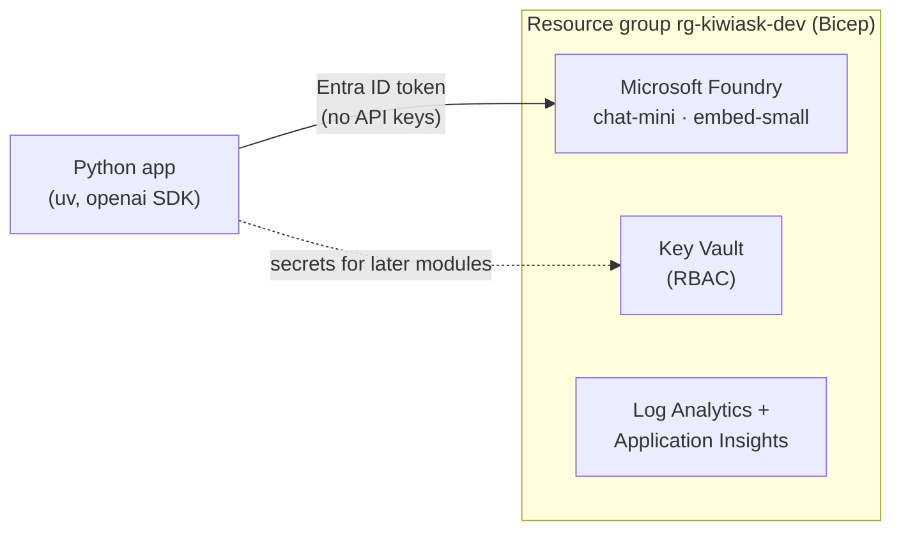

# KiwiAsk

[](https://github.com/hxush158/kiwi-ask/actions/workflows/ci.yml)

An AI assistant that answers questions about New Zealand public-service guidance
(Tenancy Services, Natural Hazards Commission Toka Tū Ake, ACC), built on Azure.
It is a learning and portfolio project: the goal is a small but production-minded
service, developed with coding agents and run like a real system.

## Why grounding matters

Early experiments asked `gpt-5-mini` whether a landlord may raise the rent again
eight months after the last increase. At all four reasoning levels the model got
the NZ rule wrong (one answer cited a 180-day interval; the rule is 12 months).
It also used an outdated agency name (EQC) and missed the statutory pet bond
introduced on 1 December 2025. More reasoning does not fix missing or stale
knowledge, so KiwiAsk grounds its answers in official guidance and cites it.

## Status

| Module | Scope | Status |
| --- | --- | --- |
| M0 Foundation | Azure environment as code, keyless auth, model-calling prototypes, CI | Done |
| M1 Document RAG | Ingest official guidance, hybrid search + semantic ranking, cited answers, deployed as an API | Next |
| M2 Evaluation & observability | Evaluation set as a CI gate, tracing, content safety | Planned |
| M3 Operations | Alerts, load testing, incident drills, runbooks | Planned |
| M4 Routing agent (optional) | Route an enquiry across agencies, conversation memory | Planned |

## Architecture (M0)



Key decisions:

- **Keyless, least privilege.** API keys are disabled on the Foundry resource
  (`disableLocalAuth`). Callers authenticate with Entra ID, and RBAC roles are
  scoped to single resources, not the resource group or subscription.
- **Everything as code.** `infra/main.bicep` defines the whole environment. It was
  deployed to a fresh resource group and validated before the portal-built
  original was removed.
- **Provider-neutral client.** Models are called through the OpenAI SDK against the
  Azure v1 endpoint; code refers to deployment names from configuration, never to
  model names.

## Repository layout

```
infra/            Bicep for the Azure environment (see infra/README.md)
src/kiwi_ask/     Python package
  common/         Shared client setup (Entra ID token provider, v1 endpoint)
  m0_*.py         M0 prototypes: reasoning effort, streaming, structured output,
                  tool calling, embeddings
tests/            Unit tests (no Azure calls; CI has no credentials)
docs/             Development log
AGENTS.md         Instructions for coding agents working in this repo
Makefile          `make verify`: format check, lint, type check, tests
```

## Run it

Prerequisites: an Azure subscription, Azure CLI, [uv](https://docs.astral.sh/uv/)
and Python 3.11.

1. Deploy the infrastructure by following [infra/README.md](infra/README.md).
2. Create `.env` in the repository root:

   ```
   AZURE_OPENAI_ENDPOINT=https://<foundry-name>.openai.azure.com/
   CHAT_DEPLOYMENT=chat-mini
   EMBED_DEPLOYMENT=embed-small
   ```

3. Sign in and run:

   ```bash
   az login
   uv sync
   uv run kiwi-ask                              # one question, one answer
   uv run python -m kiwi_ask.m0_tools           # tool calling: rent-increase timing check
   uv run python -m kiwi_ask.m0_embedding       # semantic and cross-lingual similarity
   ```

4. Check everything before committing: `make verify`.

## How it is built

Development follows a "spec → task → agent → verify → review" loop:

- **AGENTS.md** gives coding agents the project's conventions and rules.
- **`make verify`** is the definition of done for every change, and GitHub Actions
  runs it on every pull request.
- **[docs/ai-workflow.md](docs/ai-workflow.md)** (in Chinese) records each task:
  how it was specified, what the checks caught, and where agent or model output
  was wrong and how that was found.

## Disclaimer

KiwiAsk is a personal learning project. It is not affiliated with Tenancy Services,
the Natural Hazards Commission or ACC, and its answers are not legal advice.
Always check the official source.
